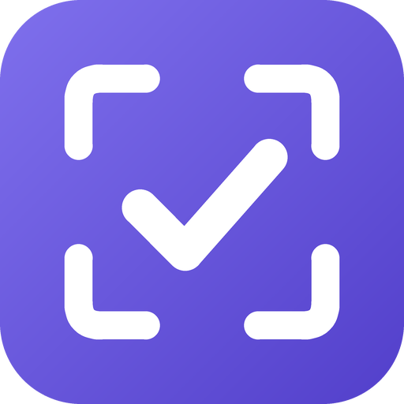

<p align="center">
  
</p>

<h1 align="center">Later</h1>

<p align="center">
  <b>Keep screenshotting. Later handles it.</b><br/>
  An Android app that turns the screenshots you take "to deal with later" into one-tap actions.
</p>

<p align="center">
  Built for the DEV <b>Hacktoberfest 2026 Open-Source AI Challenge, Week 3: "Slow and Steady"</b>
</p>

---

## The lazy habit it rewards

Everyone screenshots things to deal with later: an event poster, a bill, an address, a link,
a chat message with a deadline. Then the screenshots pile up and nothing happens.

Later doesn't ask you to change that habit. **You keep screenshotting. You don't even open the app.**
In the background, an **open-weight vision model** reads each new screenshot and turns it into
the one action it needs:

| You screenshot… | Later makes it… | One tap |
|---|---|---|
| 🎤 An event poster | **Event**: date, time, venue | Add to calendar |
| 💡 An electricity bill | **Bill**: amount + due date | Add reminder |
| 💬 "submit the form by Monday 5 PM" | **To-do** with a real date (Mon 26 Oct, 17:00) | Add reminder |
| ☕ A café listing | **Place** with the address | Open in maps |
| 🔗 An article or product | **Link** | Open link |
| 📝 A recipe or instructions | **Note** | Copy text |
| 😂 A meme | **Skipped** | – |
| 🔒 An OTP or bank screen | **Private**: skipped, nothing kept | – |

At **8 PM** you get one notification: *"12 screenshots today, sorted: 2 events, 1 bill, 3 links. Tap to handle them in one go."*

## How it works

```
Screenshot taken ──▶ WorkManager job (every ~15 min, even with the app closed)
                       │  finds new files in the Screenshots folder (MediaStore)
                       │  shrinks each to 1600 px JPEG
                       ▼
             FastAPI backend on Render ──▶ Qwen 3.8 27B (open weights, vision) on Groq
                       │  returns {kind, title, summary, date, time, location, amount, url}
                       ▼
             Saved on the phone ──▶ one-tap actions + 8 PM digest notification
```

- **No calendar, maps or browser permissions.** Actions hand off to apps you already have through standard Android intents (a pre-filled "new event" screen, a `geo:` link, and so on).
- **Private screenshots stay private.** The model is told to classify OTPs, passwords, bank details and ID documents as `private` and return nothing else; the backend strips any details from private results too. Nothing is stored on the server.
- **Relative dates work.** The phone sends today's date, so "this Friday" or "Monday 5 PM" becomes a real calendar date.
- **Free-tier friendly.** About 4 screenshots per background run, with automatic wait-and-retry when the free model tier says "slow down".

## Open source at the core

| Piece | Role |
|---|---|
| **Qwen 3.8 27B** (open-weight, text + vision) | Reads every screenshot and decides the action |
| **FastAPI** | The small backend between the app and the model |
| Any OpenAI-compatible endpoint | Groq today; Hugging Face or a local **Ollama** server by changing three environment variables, which matters for an app that reads screenshots |

## Run it yourself

### Backend
```bash
cd backend
python -m venv .venv
.venv\Scripts\activate            # macOS/Linux: source .venv/bin/activate
pip install -r requirements.txt
copy .env.example .env            # add your Groq key and an APP_KEY
uvicorn main:app --reload --port 8000
```

| Method | Path | Body | Returns |
|---|---|---|---|
| `GET` | `/` | | Health check |
| `POST` | `/analyze` | multipart: `image`, `today` (YYYY-MM-DD), `weekday` | `{kind, title, summary, date, time, location, amount, url}` |

`/analyze` requires the `X-App-Key` header when `APP_KEY` is set.

**Deploy:** push the repo, then in Render choose **New → Blueprint** (it reads `render.yaml`) and set `LLM_API_KEY` and `APP_KEY`.

### Android app
1. Open the **`android/`** folder in Android Studio (JDK 21+, SDK 37).
2. Add `APP_KEY=…` (same as the backend) to `android/local.properties` (never committed).
3. Set `BACKEND_URL` in `android/gradle.properties` to your Render URL.
4. Run it, allow access to photos, and take a screenshot of something you'll "deal with later".

## Project structure
```
backend/main.py                      FastAPI: /analyze, prompt, privacy rules, rate-limit retries
android/app/src/main/java/com/example/later/
  MainActivity.kt   Tabs (To handle / Done / Skipped), permissions, scan, digest preview, theme
  Scanner.kt        Finds new screenshots, sends a few per run, ScanWorker (background)
  Screenshots.kt    MediaStore queries, shrinking for upload, thumbnails
  Digest.kt         8 PM summary notification + DigestWorker
  Scheduler.kt      WorkManager: scan every 15 min, digest at 8 PM
  Actions.kt        One-tap intents: calendar, maps, browser, clipboard
  ShotAdapter.kt    Screenshot cards
  ShotStore.kt      Everything saved on the phone
render.yaml         Render blueprint
```

## License
[MIT](LICENSE)
